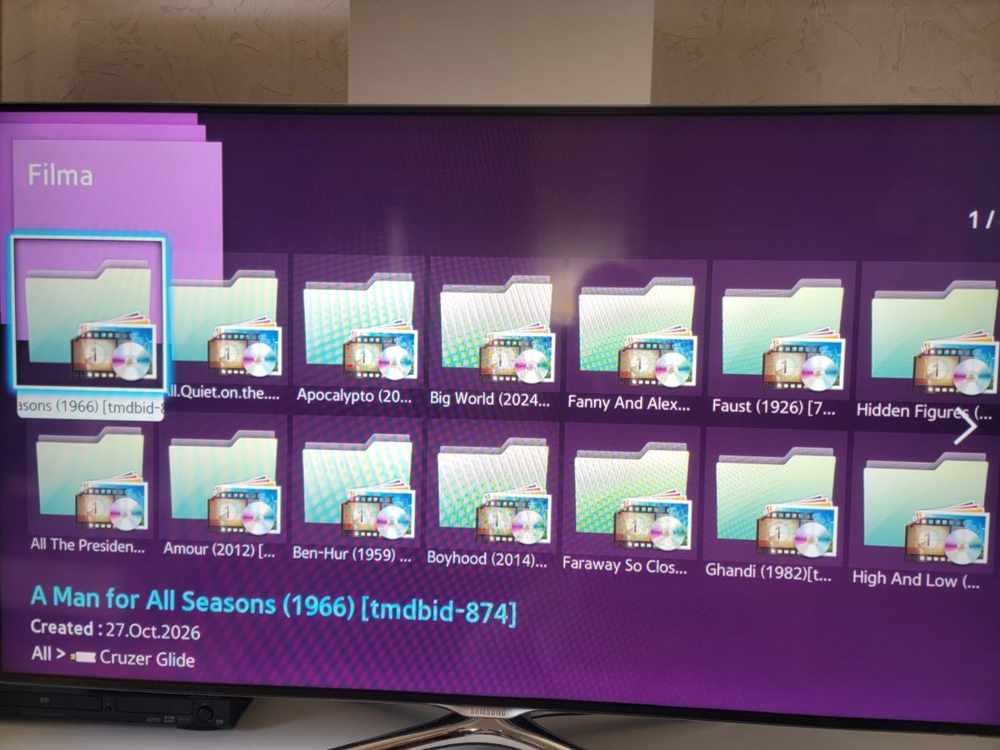
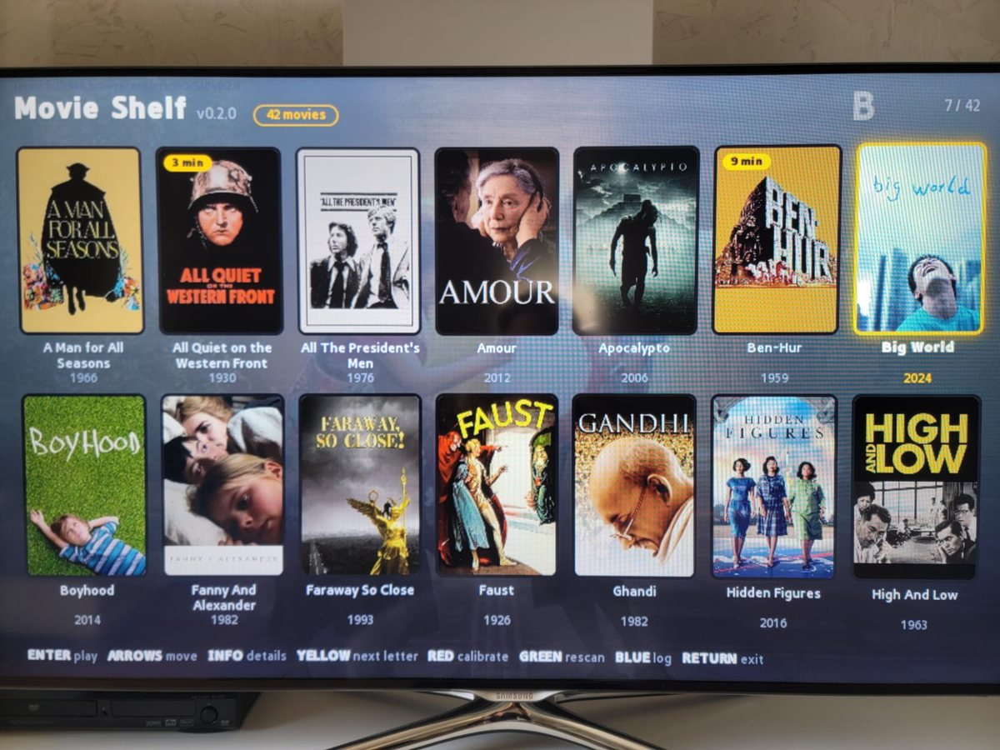
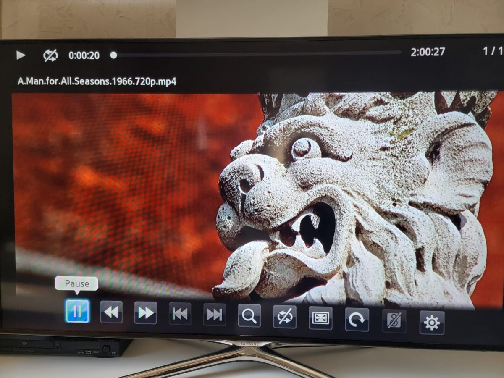
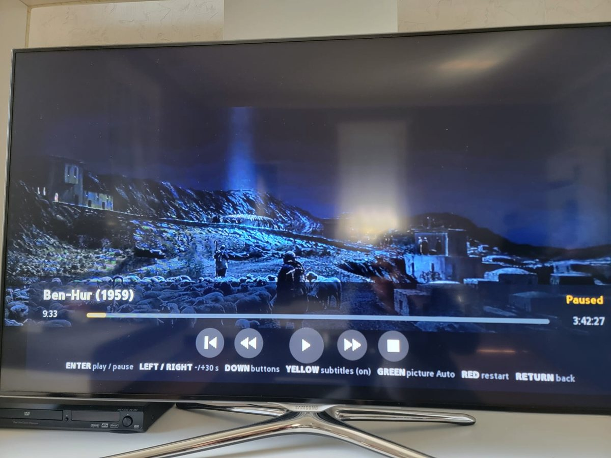
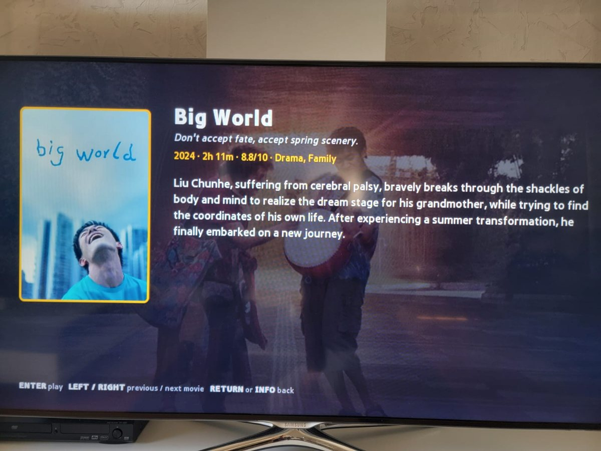

# Movie Shelf

**A poster shelf for the movies on your USB drive, on older Samsung Smart TVs.**

Plug a USB drive into a Samsung F-series TV (2013, "Orsay" Smart Hub) and its built-in browser shows a wall of grey folder icons and plays files with no cover art. Movie Shelf replaces that with a poster grid, a details screen, and a proper player with resume and subtitles. It runs on the TV itself. No streaming box, no PC left running, no server.

Built and tested on a Samsung UE46F6500. Current version: **0.2.9**.

## Before and after

| The TV's own file browser | Movie Shelf |
|---|---|
|  |  |

| The TV's own player | Movie Shelf's player |
|---|---|
|  |  |

Press **INFO** on a movie for the plot, rating, runtime, genres, director, writers, cast and country:



## What you get

- **A poster grid**, sorted by title (A-Z, "Part 2" before "Part 10"), with a scroll bar and a jump to the next letter.
- **A details screen** (INFO key) with poster, plot, rating, runtime, genres, director, writers, cast and country on top of the movie's backdrop picture.
- **A player** with play/pause, jump 30 seconds, restart and stop buttons, a progress bar, and the right picture shape for 4:3 and widescreen movies.
- **Resume**: leave a movie and it continues where you stopped. A small amber badge on the poster shows the minutes already watched.
- **Watched marks**: a movie that played to the end (or that you stopped in the last minute) gets a small eye on its poster. You can set or clear the mark yourself on the details screen.
- **Subtitles**: a `.srt` file next to the movie is picked up automatically.
- **Posters and details downloaded for you**: two small scripts fill in the pictures and text from TMDB, the way Jellyfin does.
- **Friendly messages** when no drive is plugged in, the folder is missing or it holds no movies.

## What you need

- A Samsung **F-series TV from 2013** (model code like `UE46F6500`) with the Smart Hub. Other Orsay-era models may work but are untested.
- A PC on the same network, only to install the app (and to prepare the drive).
- Python 3. For posters: a free TMDB key and, optionally, Pillow (`python -m pip install pillow`).
- A USB drive with your movies.

## Quick start

1. **Prepare the drive.** Put a folder named `Filma` on it, with one folder per movie inside (see below).
2. **Start the install server** on the PC: `python tools/serve.py`. It prints the PC's IP address. (Port 80 may need an administrator terminal.)
3. **Tell the TV where it is.**
   - MENU > Smart Features > Samsung Account > Log in with the ID `develop`.
   - SMART HUB > More Apps > Options > IP Setting > enter the PC's IP address.
   - Options > Start App Sync. Open the **newest** Movie Shelf entry.
4. **Plug in the drive** (before or after starting the app). The shelf appears.

After a code change, restart `serve.py` and run App Sync again. Each start creates a new entry in More Apps, because the TV remembers apps by id and would otherwise keep showing the old version; delete old entries now and then. The version number next to the title tells you which one you are looking at.

## Set up your movie folders

```
E:\
  Filma\
    Heat (1995) [tmdbid-949]\
      heat.mp4
      heat.srt              subtitles, optional
      poster.jpg            poster, optional
      backdrop.jpg          backdrop picture, optional
      heat.tmdb.json        details for the INFO screen, optional
    Rope (1948)\
      rope.mkv
```

- Only the `Filma` folder is scanned (any capitalisation, found up to 3 levels down). Movies can sit up to 4 levels inside it.
- **One video per folder** is one movie, titled by the folder name. Dots and underscores become spaces, the year is split out, and tags like `1080p`, `BluRay` or `[tmdbid-949]` are hidden.
- A folder with **several videos** shows one entry per video.
- **Subtitles**: a `.srt` named like the video (`heat.srt`, `heat.en.srt`). In a folder with one video, any `.srt` works; with several, the first alphabetically wins.
- **Poster**: one named like the video, else `poster.*`, `folder.*`, `cover.*`, else any jpg/png in the folder.
- **Backdrop**: `backdrop.jpg`, `fanart.jpg` or `background.jpg` (Jellyfin's names). For one of several videos: `<video name>.backdrop.jpg`. Jellyfin's `logo`, `banner`, `thumb` and `landscape` files are ignored, and a backdrop is never mistaken for a poster.
- Video types: mp4, m4v, mkv, avi, mov, wmv, ts, mpg, mpeg. Whether a file plays still depends on the TV's decoder.

## Get posters and details automatically

Two scripts do this. Both are safe to try: they only show what they would do until you add `--apply`.

**1. Get a free TMDB key** at https://www.themoviedb.org/settings/api (the "API Key" or the long "Read Access Token", both work) and set it. In PowerShell, for the current window:

```
$env:TMDB_API_KEY = "your_key"
```

or permanently with `setx TMDB_API_KEY "your_key"` (new terminals only). The key is never written to disk, so keep it out of the repository too.

**2. Give each folder its TMDB id** (skip if the names already have it). `tmdb_tag.py` searches TMDB by the folder's title and year and renames `Heat (1995)` to `Heat (1995) [tmdbid-949]`:

```
python tools/tmdb_tag.py E:\            shows the renames, changes nothing
python tools/tmdb_tag.py E:\ --apply    does them
python tools/tmdb_tag.py E:\ --undo --apply    puts the old names back
```

It renames only when it is certain: the title is identical and the year agrees (or, without a year, only one movie has that title). Everything else is printed as `unsure` with candidates, and you add those ids by hand: the id is the number in the movie's TMDB address, `themoviedb.org/movie/949-heat`. Every rename is logged in a hidden `.tmdb_renames.log` inside `Filma`, which `--undo` uses.

**3. Download the pictures and text.** `tmdb_posters.py` handles every folder whose name has `[tmdbid-N]` and ignores the rest:

```
python tools/tmdb_posters.py E:\            shows what it would download
python tools/tmdb_posters.py E:\ --apply    downloads
```

For each movie it saves, into the movie's own folder:

| File | What | Used for |
|---|---|---|
| `poster.jpg` | poster, 300x450 | the tiles |
| `backdrop.jpg` | backdrop picture, 640x360 | the shelf background and the INFO screen |
| `<video name>.tmdb.json` | title, year, tagline, rating, runtime, genres, director(s), writers, the first 8 cast members, countries, plot | the INFO screen |

Existing files are never replaced (apart from an outdated details file, see "Good to know"), and each file is checked on its own, so running it again only fills the gaps. Delete a file to fetch it again. Options: `--posters-only`, `--size` (poster size, default `w342`), `--language` (default `en-US`, also the language of the plot). With Pillow installed the pictures are shrunk to the sizes above, which the TV likes; without it they are saved as TMDB delivers them.

Already have posters that are too big for the TV? `python tools/posters.py E:\ --apply` shrinks them to 300x450 (the old file is kept as `poster.orig.bak`).

## Using the remote

| Where | Key | What it does |
|---|---|---|
| Shelf | Arrows | Move (Left/Right wrap to the next row) |
| Shelf | Enter / Play | Play |
| Shelf | **Info** | Details screen |
| Shelf | Yellow | Jump to the next letter |
| Shelf | Green | Look for the drive and movies again |
| Shelf | Blue | Show or hide the log (for troubleshooting). Opening it also sends the log to the PC |
| Shelf | Red | Calibration screen (shows what the TV really displays) |
| Shelf | Return | Exit |
| Anywhere | Volume +/-, Mute | Change the volume. A bar with a speaker icon and the level (0-100) shows at the top right for a moment; Mute shows a crossed-out speaker and "MUTE". Changing the volume while muted ends the mute |
| Details | Left / Right | Previous / next movie |
| Details | Enter / Play | Play |
| Details | Yellow | Mark the movie as watched / not watched (the eye badge on its poster follows) |
| Details | Return / Info | Back to the shelf |
| Playing | Enter / Play / Pause | Pause / resume |
| Playing | Left, Right / RW, FF | Jump 30 seconds |
| Playing | Down, then Left/Right, Enter | Pick and press a button on the screen |
| Playing | Yellow | Subtitles on / off |
| Playing | Green | Picture shape: Auto / 16:9 / 4:3 / 1.85:1 / 2.35:1 (remembered per movie) |
| Playing | Red | Restart |
| Playing | Return / Stop | Back to the shelf (remembers the position if you got past 1 minute) |

## Good to know

These are the known limits, so nothing comes as a surprise.

**Movies and folders**
- A folder with exactly one video is one movie and its subfolders are not scanned, so a movie folder that also holds other movie folders hides the inner ones.
- An extra video next to a movie (a `sample.mp4`, a trailer) makes the folder list one entry per file.
- Only `Filma` is scanned; there is no fallback to the whole drive.
- Unplugging the drive while browsing is not noticed. Press Green to look again.

**Playing and subtitles**
- Only `.srt` subtitles are read (no `.ass`, `.vtt`, `.sub`), as UTF-8 or Windows-1252. Other encodings can show wrong letters.
- The widget draws the subtitles itself, following the player's clock to within a fraction of a second. There is no sync adjustment and no choice between several subtitle files. The bundled font (Open Sans SemiBold) covers Western European letters only.
- The picture is fitted to the video's pixel size. Videos with non-square pixels (some DVD rips) may look slightly stretched; Green lets you pick another shape.
- If the TV cannot decode an audio track (some AC3/DTS tracks in MP4), the movie plays without sound. The widget cannot change that.
- The widget cannot hand a file to the TV's own player, so the on-screen controls are the widget's.

**The TV and the install**
- Developed on one TV (UE46F6500). Other models may report other screen sizes, lack some plugin calls, or not deliver the INFO key to widgets.
- Resume positions are saved only when you leave after 1 minute and with more than 1 minute left. They live in a file on the TV, not on the drive, and so do the watched marks. A drive moved to another TV starts without them.
- Every `serve.py` start adds a new entry to More Apps; delete the old ones by hand.
- The plot is cut at about 430 characters, and its language is the one used when it was downloaded. Names (director, cast) come from TMDB as they are written there.
- A details file written by an older version (no director or cast) is refreshed once by the next `tmdb_posters.py --apply`; it is the only existing file the script ever replaces.
- The shelf's tint comes from the poster's average color when the TV allows reading it; otherwise a color picked from the title is used.
- The TMDB scripts have been tried on a real drive, but their tests only use a fake TMDB.

## Troubleshooting

Press **Blue** on the shelf to show the log. It is the first thing to look at, and it starts fresh every time the app starts.

**The log also goes to your PC.** Opening it sends it to `serve.py`, which prints it in its window and saves it under `tools/_logs/` (one file per press). So you can copy it instead of photographing the screen. The last line of the on-screen log says whether that worked. It needs `serve.py` to be running, and the build to come from it, because `serve.py` writes its own address into every build.

| Symptom | Cause and fix |
|---|---|
| The TV keeps showing an old version | It remembers apps by id. Restart `serve.py` (new id), run App Sync again, open the newest entry, and compare the version next to the title with the one `serve.py` printed. |
| Install fails with `UndocumentedAPI '...'` | The TV's installer found an API name it does not know in the page text. Names like that must be built at runtime, as `usb.js` does. |
| Black screen, no keys | Check `config.xml` (Samsung format, `<type>user</type>`, 960x540). A page that never calls `sendReadyEvent` stays on "Loading". |
| Tiles or text cut off at the edge | The widget space is 960x540 whatever the browser reports. Press Red on the shelf for the calibration screen. |
| "No USB drive found" | Plug it in (the shelf looks again every few seconds) or press Green. |
| "Folder Filma not found" | Create a folder named `Filma` on the drive, with one folder per movie. |
| A movie has no poster | Add `poster.jpg` or run the TMDB scripts. Very large or progressive JPEGs can fail on the TV; Pillow converts them to 300x450 baseline. |
| INFO does nothing | In the log, `INFO key registered` should appear at start, and `Unhandled key N` shows what the remote sent. Without it the TV is not delivering the key. |
| INFO says "No details", or shows no director or cast | The details file on the drive is missing or from an older version. The folder name needs `[tmdbid-N]` (`tmdb_tag.py` adds it); then run `tmdb_posters.py --apply` with the drive in the PC and press Green on the shelf. |
| Subtitles look different from the TV player | The log shows `Subtitle font: loaded` or `NOT loaded`. The widget draws them itself, not the TV. |
| The picture is the wrong shape | The log shows `Video size WxH` and `Picture area`. Press Green while playing to pick another shape. |
| `serve.py` says the port is in use | Another copy is still running. Stop it first. |
| "Set the TMDB_API_KEY" | Open a new terminal after setting the key, or set it in the same window with `$env:TMDB_API_KEY = "..."`. |
| "TMDB rejected the key (HTTP 401)" | The key is wrong or was copied with a space. |

## For developers

### Project layout

```
widget/              the Orsay widget (config.xml, index.html, css/, fonts/, icon/, img/, js/)
  js/main.js         grid, focus, scanning states, details screen, key handling, calibration
  js/usb.js          find the USB mount, walk folders, pick posters/backdrops/subtitles, clean titles, sort
  js/player.js       playback, transport bar, picture shape, resume, subtitle clock
  js/subs.js         SRT parser and loader
  js/info.js         reads <video>.tmdb.json for the INFO screen
  js/store.js        resume positions (FileSystem common file MovieShelf/resume.json)
  js/log.js          on-screen log (Blue key), sends itself to the PC when opened
tools/serve.py       zips widget/, writes widgetlist.xml, serves it on port 80 for App Sync, saves logs the TV sends
tools/tmdb_tag.py    adds [tmdbid-N] to folders (TMDB search, only certain matches, --undo)
tools/tmdb_posters.py downloads posters, backdrops and details from TMDB by id
tools/posters.py     shrinks existing posters to 300x450 (needs Pillow)
test/                node and python tests (below)
docs/screenshots/    the pictures in this README
.github/workflows/   runs the tests on every push
```

`python tools/serve.py --stable-id` keeps the plain widget id instead of stamping a new one. The version shown on the shelf comes from `VERSION` in `js/main.js` and `<ver>` in `widget/config.xml`; a test makes sure they match.

### Tests

```
node test/scan.test.js       scanning, titles, sorting, subtitles, backdrops, version match, ASCII-only scripts
node test/info.test.js       the details file
node test/player.test.js     playback logic (shape, keys, resume, watched marks) against a fake TV plugin and fake timers
node test/log.test.js        the on-screen log and sending it to the PC
node test/store.test.js      saved positions, watched marks, picture shapes (in-memory FileSystem)
node test/shelf.test.js      the shelf, the details screen, the watched marks and the backdrop (fake drive, fake DOM)
node test/volume.test.js     the volume keys and the volume bar
python test/test_tmdb.py     both TMDB scripts against a fake TMDB
python test/test_serve.py    the log endpoint of serve.py and the address written into each build
```

None of them needs a TV, a key or the internet, and GitHub Actions runs all of them on every push. They cannot tell how the old TV browser draws something; that still needs a look at the TV.

### What the TV taught us

Orsay's browser is old WebKit: ES5 only (no `let`/`const`, arrow functions or template literals), no flexbox, partial CSS3.

- Widgets are laid out in a **960x540** space. `window.innerWidth` reports whatever `config.xml` declares, so it is logged but not trusted.
- The TV's installer rejects pages that contain undocumented API names as plain text (`GetUSB...`), so `usb.js` builds those names at runtime.
- `readDir` returns folders as `name/` and includes `./` and `../`.
- Script files must be ASCII-only (write non-ASCII characters as unicode escapes, backslash-u plus four digits), because the TV may decode them with the wrong charset. A test enforces it.
- Avoid `opacity` on many absolutely positioned elements and separate full-screen backdrop layers: they stack wrongly on this browser. The shelf backdrop is therefore the shelf's own CSS background.
- Video plays on a plane behind the page, so the page goes transparent (`body.playing`) during playback. The TV stretches the picture to the area it is given, so the area must have the video's shape.
- The TV keeps a cached copy of a widget per id, hence the stamped id.
- The INFO key reaches a widget only after `registKey`.
- On the UE46F6500 the volume and mute keys are delivered to the widget, and `unregistKey` does not hand them back to the TV. The widget has to change the volume itself (audio plugin, `SetVolumeWithKey`) and draw its own volume bar.

### Ideas

A "continue watching" row, other subtitle formats, subtitle sync adjustment, collections (folders of related movies) as one tile.

## License

MIT, see `LICENSE`. The bundled subtitle font is Open Sans SemiBold under the SIL Open Font License (`widget/fonts/OpenSans-OFL.txt`). Poster, backdrop and plot data come from TMDB (https://www.themoviedb.org); this project is not endorsed or certified by TMDB.
